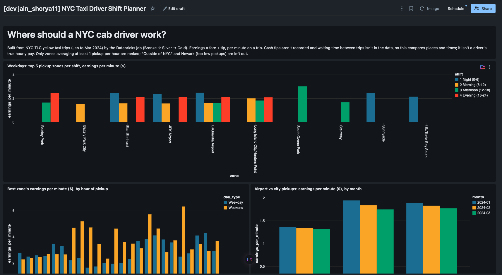
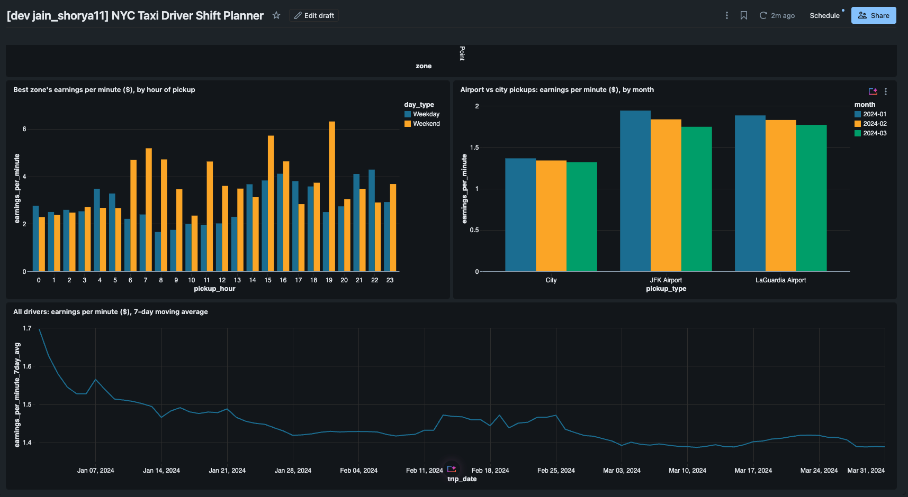

# NYC Taxi Driver Shift Planner on Databricks

**The problem:** NYC yellow-cab drivers pick where and when to work mostly by habit. This project answers it with data: at a given hour, on a weekday or weekend, which pickup zones earn the most per minute on a trip, which shifts pay best, and whether airport pickups are worth it.

**How:** a batch data pipeline on Databricks in Python, PySpark and SQL. Monthly raw trip files are loaded into Delta Lake tables, cleaned and validated, and summarized into reporting tables behind a dashboard. The data is the public NYC TLC yellow taxi trip records for January to March 2024 (one Parquet file per month), plus the TLC zone lookup.

**Definitions and limits:** driver earnings = fare + tip (taxes, surcharges and tolls aren't the driver's). Earnings per minute = total earnings / total trip minutes. Cash tips aren't recorded, and the data has no driver ID or waiting time, so this compares places and times; it isn't a driver's true hourly pay.

## How it works

```text
scripts/download.py     download a month's file and upload it to a Databricks Volume
        │
Bronze  pipeline_bronze.trips_raw      as received (text), + source file, load time, month
        │   check: row count > 0
Silver  pipeline_silver.trips          typed, validated, deduplicated, joined to zone names
        pipeline_silver.quarantine     invalid rows, with the reasons they failed
        │   checks: invalid-row rate < 5%, trips + quarantine = bronze rows
Gold    pipeline_gold.zone_hour_earnings  earnings per minute by zone, weekday/weekend, hour, ranked
        pipeline_gold.shift_best_zones    top 5 zones per shift
        pipeline_gold.airport_vs_city     airport vs city pickups, month-over-month change
        pipeline_gold.daily_summary       driver earnings per day, 7-day moving average
        │   check: Gold earnings = Silver earnings
Dashboard  "Where should a NYC cab driver work?": 4 charts on the Gold tables
```

- **Cleaning** (`src/pipeline/silver.py`): every column is cast to a fixed type with `try_cast`. Every row is checked against 10 rules, and failures go to `quarantine` with a reason code, so nothing is dropped silently. Repeated trips keep one copy.
- **Safe to rerun** (`write_month`): each write replaces only its own month with Delta `replaceWhere`. Running a month twice gives identical tables.
- **Quality checks** (`src/pipeline/quality.py`): every result is logged to `pipeline_ops.dq_results`. A failed check fails its task, and Databricks skips the rest of the job, so reporting tables keep their last good data.
- **Job** (`resources/job.yml`): 6 tasks on serverless compute, deployed with a Databricks Asset Bundle. It runs on a monthly schedule (06:00 UTC on the 5th) with `month=latest`, which processes the newest month folder in the landing Volume; a manual run can pass a specific month. Landing a new month's file is a separate step (`scripts/download.py`).

## Results (real data, measured 2026-11-09)

| Month | Raw rows | Clean rows | Quarantined | Invalid rate | Job time |
| --- | --- | --- | --- | --- | --- |
| 2024-01 | 2,964,624 | 2,868,035 | 96,589 | 3.26% | 2m57s |
| 2024-02 | 3,007,526 | 2,899,875 | 107,651 | 3.58% | 8m00s |
| 2024-03 | 3,582,628 | 3,438,434 | 144,194 | 4.03% | 2m48s |
| **Total** | **9,554,778** | **9,206,344** | **348,434** | **3.65%** | |

- Most common reasons: distance zero or missing (215,764), bad amounts (136,908), meter left running over 3 hours (6,103).
- **What drivers learn:** airport pickups earn more per minute on a trip than city pickups (JFK $1.75 to $1.94, city $1.32 to $1.37 per minute, Jan to Mar), and about four times as much per trip. Airport queue time isn't in the data, so this is the upper bound of the airport's advantage.
- Rerunning March left every count and total identical. Gold earnings equal Silver earnings to the cent each month.
- A failure drill with ~10% of January's distances zeroed stopped the job at the Silver check (12.92% invalid, limit 5%). Gold was unchanged, and restoring the real file brought every table back exactly.
- 32 unit tests (pytest, local Spark with Delta), run in CI on every push.

## Run it

```bash
python3.12 -m venv .venv && .venv/bin/pip install -e ".[dev]"
.venv/bin/pytest -q && .venv/bin/ruff check .

databricks auth login --host https://YOUR-WORKSPACE-URL     # and set the host in databricks.yml
.venv/bin/python scripts/download.py --months 2024-01,2024-02,2024-03
databricks bundle deploy -t dev
databricks bundle run pipeline_job -t dev --params month=2024-01
```

## Dashboard




## Project layout

```text
src/pipeline/   config, bronze, cleaning, silver, gold, quality, tasks
sql/gold/       one SELECT per reporting table
jobs/           run_task.py, the entry point every job task runs
resources/      job and dashboard definitions (Asset Bundle)
dashboards/     dashboard definition
scripts/        download.py, sql.py (query the SQL warehouse)
tests/          pytest
```
